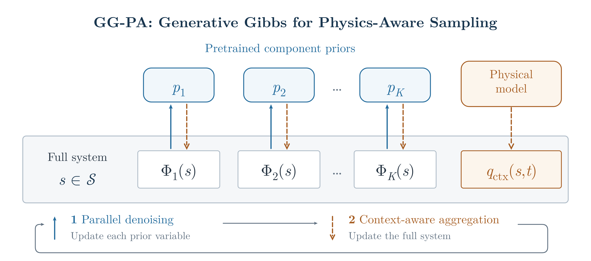
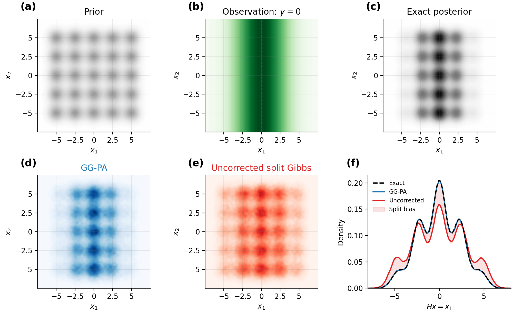
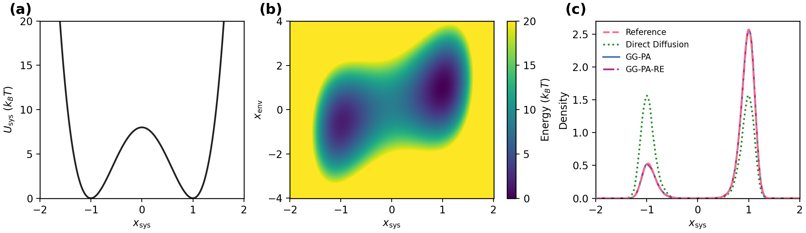
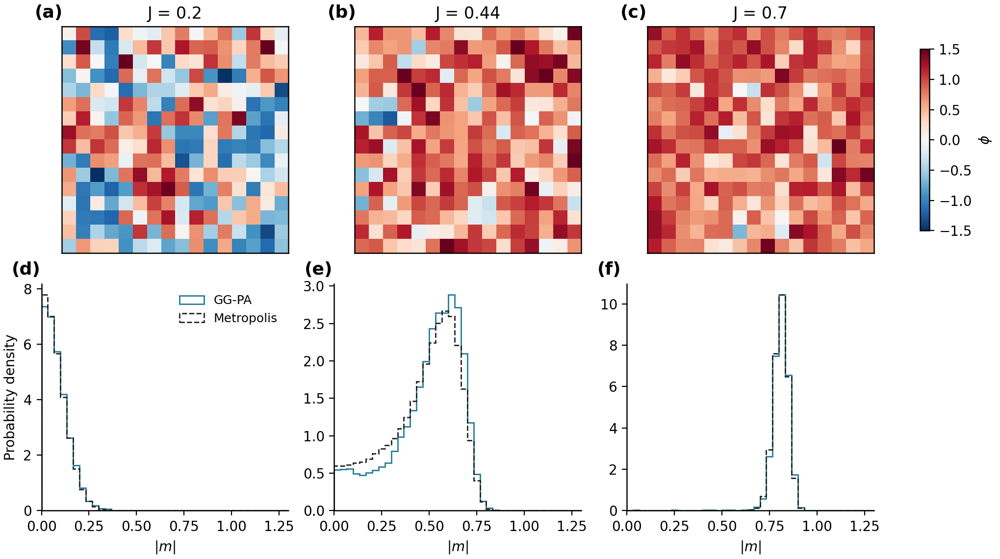
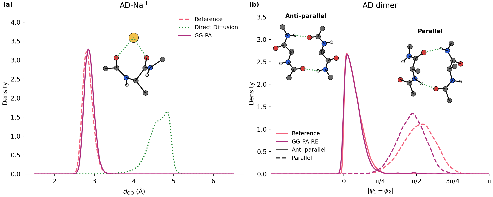

# GG-PA: Generative Gibbs for Physics-Aware Sampling

This repository contains the companion package for

> **Composing Diffusion Priors with Explicit Physical Context via Generative Gibbs Sampling**
>
> Weizhou Wang, Jonathan Weare and Aaron R. Dinner · NeurIPS 2026
>
> [Read the paper](https://arxiv.org/abs/2605.10642)



**Figure 1. GG-PA composition.** Component priors act on projections of a shared system; the physical context also governs degrees of freedom outside the priors. Blue arrows show parallel denoising, and dashed amber arrows show context-aware aggregation. The two updates form a Gibbs sweep.

GG-PA is an **inference-time composition framework** that combines pretrained diffusion priors with explicit physical context to sample a joint system without retraining. It supports three settings:

- **Unbiased sampling for linear inverse problems.** For Gaussian observation noise, GG-PA corrects the likelihood covariance to remove split Gibbs bias at finite split noise.

- **Unbiased composition through quadratic interactions.** GG-PA accounts for diffusion noise in the interaction, recovering the desired joint distribution at finite diffusion time.

- **Composition with general physical environments.** Combine learned component priors with explicit interactions, including nonquadratic molecular forces.

The repository includes three pretrained checkpoints, two CPU quickstarts with analytic references, $\phi^4$ lattice and alanine examples, and configurations for the paper applications.

## Quick start

The quickstarts demonstrate unbiased linear inverse sampling and composition of a learned double-well prior with a quadratic environment. With **PyTorch, NumPy, SciPy, Matplotlib and PyYAML** available, run from the checkout:

```bash
bash quickstart.sh
```

No installation is needed. Both run on CPU in about five minutes and save results to `runs/quickstart_<timestamp>/`; settings are in the [quickstart guide](quickstart/README.md).

### 1. Solve a linear inverse problem without split bias

For $y=Hx+\eta$ with Gaussian noise covariance $\Sigma_\eta$, split Gibbs with split noise $\rho$ inflates the observation covariance to $\Sigma_\eta+\rho^2HH^T$ and **samples the wrong posterior, even after convergence**.

GG-PA supplies the correction:

$$
\Sigma_{\mathrm{split}}=\Sigma_\eta-\rho^2HH^T
$$

with admissible noise $0<\rho<\rho_{\max}$, where

$$
\rho_{\max}=\left[\lambda_{\max}\!\left(\Sigma_\eta^{-1/2}HH^T\Sigma_\eta^{-1/2}\right)\right]^{-1/2}.
$$

In this range the corrected covariance is positive definite and the posterior is exact; larger $\rho$ mixes faster without bias.



**Figure 2. Linear inverse problem.** Top: prior, observation likelihood and exact posterior. Bottom: GG-PA, uncorrected split Gibbs and their marginals along the observed coordinate. GG-PA follows the target; uncorrected splitting puts excess mass in the outer columns. Red shading marks its persistent target bias.

### 2. Couple a pretrained diffusion model to an environment

A diffusion model trained on an isolated, symmetric double well (Figure 3a) is coupled to a harmonic environment that favors the right well. GG-PA recovers the shifted distribution without retraining, using the same finite-noise correction as the inverse problem; direct diffusion still samples the isolated system. GG-PA-RE adds replica exchange over diffusion time.



**Figure 3. Double well in a harmonic environment.** (a) Isolated training potential. (b) Coupled potential energy surface. (c) Distributions along $x$ from direct diffusion, GG-PA and GG-PA-RE, compared with the exact physical marginal (dashed).

### How composition works

GG-PA keeps a full-system state alongside one sample per component prior; projections select the coordinates each prior models. Each Gibbs sweep has two updates (Figure 1):

1. **Parallel denoising.** Each prior treats its projected coordinates as a noisy observation and samples a clean configuration; the priors update independently.

2. **Context-aware aggregation.** The full system is updated under the physical context and the couplings to those samples.

Everything is built with `compose(priors, context, ...)`; the [manual](docs/manual.md) describes the API.

## Installation

Install from the repository root:

```bash
python -m pip install ".[md,figures]"
```

## Examples and manual

The examples use the supplied checkpoints and YAML settings; run them from the repository root.

### $\phi^4$ lattice

A single-site double-well prior is reused across a $16\times16$ lattice. Changing the nearest-neighbor coupling produces disorder, near-transition fluctuations and ordering without retraining.



**Figure 4. $\phi^4$ lattice.** Top: sampled fields at increasing coupling $J$. Bottom: absolute magnetization distributions from GG-PA and Metropolis at the same settings.

```bash
python examples/phi4/example_phi4.py --config examples/phi4/settings.yaml
```

Allow about 15 minutes. See the [lattice guide](examples/phi4/README.md) for the model and sampling settings.

### Alanine dipeptide

A prior trained on an isolated alanine dipeptide is coupled to explicit molecular interactions. Sodium coordination draws the carbonyl oxygens together; two copies of the monomer prior form a dimer with anti-parallel and parallel hydrogen-bonded structures.



**Figure 5. Molecular contexts.** (a) Carbonyl O–O distance with $Na^+$, comparing GG-PA, direct diffusion and MD. (b) Dimer torsion differences from GG-PA-RE and MD, separated by topology. Insets show sampled structures.

```bash
python examples/alanine/example_alanine.py --config examples/alanine/settings.yaml
```

Allow about 10–15 minutes. See the [alanine guide](examples/alanine/README.md) for the molecular setup and sampling settings.

The [manual](docs/manual.md) covers the Python API and custom priors, projections and contexts.

### Paper settings

The [`configs/`](configs/) folder provides system parameters and sampling settings for the paper's [$\phi^4$ lattice](configs/phi4.yaml) and [alanine](configs/alanine.yaml) experiments.

## Citation

If you use GG-PA in your research, please cite the accompanying paper.

```bibtex
@inproceedings{wang2026ggpa,
  title = {Composing Diffusion Priors with Explicit Physical Context via Generative Gibbs Sampling},
  author = {Wang, Weizhou and Weare, Jonathan and Dinner, Aaron R.},
  booktitle = {Advances in Neural Information Processing Systems},
  year = {2026},
  eprint = {2605.10642},
  archivePrefix = {arXiv}
}
```

## License

GG-PA is distributed under the [MIT License](LICENSE).
